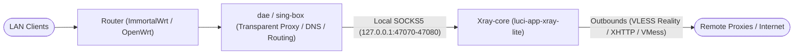

# luci-app-xray-lite

[](LICENSE)
[](https://github.com/ganganray/luci-app-xray-lite/actions/workflows/build.yml)

[English](README.md) | [简体中文](README.zh-CN.md)

A lightweight, non-intrusive OpenWrt / ImmortalWrt LuCI application designed for **Xray as a pure local outbound proxy backend**. 

It is tailor-made for setups where a modern transparent proxy core (such as **dae**, **sing-box**, or **mihomo**) handles firewall interception and DNS routing, while Xray is merely used to terminate specialized outbound protocols (e.g. VLESS Reality, XHTTP, VMess, Trojan) via localhost SOCKS5 ports (e.g. `127.0.0.1:47070-47080`).

---

## 💡 Why luci-app-xray-lite?

Most existing LuCI clients for Xray (such as `yichya/luci-app-xray` or PassWall) are full-blown transparent proxy clients. They forcefully alter system firewall rules (iptables/nftables), hijack DNS via dnsmasq/chinadns-ng, and establish their own routing tables. When running alongside `dae` or `sing-box`, this invariably causes rule conflicts, DNS leaks, and routing loops.

`luci-app-xray-lite` takes inspiration from the clean, focused interaction model of `luci-app-dae`:

| Feature | `luci-app-xray-lite` (This Project) | `yichya/luci-app-xray` / PassWall |
| :--- | :--- | :--- |
| **Firewall Modification** | ❌ **Zero touches** (No nftables / iptables changes) | ✅ Injects complex TPROXY / REDIRECT rules |
| **DNS Hijacking** | ❌ **Zero touches** (No dnsmasq overrides) | ✅ Overrides system DNS / creates local resolvers |
| **Configuration Model** | 📝 **Raw JSON editing** with instant `xray run -test` verification & automatic rollback | 📋 Heavy, opinionated Web form fields |
| **Compatibility** | 🤝 Perfect companion for `dae`, `sing-box`, `mihomo` | ⚠️ Incompatible / conflicts with other proxy cores |
| **Resource Footprint** | ⚡ Extremely lightweight (pure LuCI JS views + controlled helper) | 🐘 Heavy background watchers & rule builders |
| **Upstream Compatibility** | 📦 Fully compatible with official `openwrt/packages` `xray-core` UCI & init script | 🧩 Relies on custom UCI schemas and wrappers |

---

## 📸 Screenshots

| Settings View | Configuration View | Log View |
| :---: | :---: | :---: |
| *(Service status & UCI controls)*<br>`docs/screenshots/settings.png` | *(JSON editor with live rollback test)*<br>`docs/screenshots/config.png` | *(Real-time log tailing)*<br>`docs/screenshots/log.png` |

---

## ✨ Features

1. **Service Status & Control**:
   - Real-time running status polling (`RUNNING` / `NOT RUNNING`) via `ubus service list`.
   - Direct Start, Stop, and Restart controls.
   - Standard mapping for upstream `xray-core` UCI options (`enabled`, `confdir`, `conffiles`, `datadir`, `format`, `dialer`).
2. **Safe JSON Configuration Editing**:
   - Multi-file dropdown selector (supporting multiple configuration files under `confdir` and `conffiles`).
   - Monospace editor with Tab indentation support.
   - **Dual-layer validation & rollback protection**:
     - *Client-side*: Browser `JSON.parse` pre-check blocks malformed submissions before touching the disk.
     - *Backend-side*: Validates the configuration using `xray run -test`. If validation fails, changes are **automatically rolled back** to the previous file with detailed error diagnostics displayed in the UI, ensuring zero service disruption.
   - File permissions strictly maintained at `0600` (`-rw-------`).
3. **Real-time Log Viewer**:
   - Automatic polling of Xray daemon logs via system `logread` (or custom `log.error` file if specified).
   - Instant scroll-to-bottom and scroll-to-top buttons.
4. **Security & Least Privilege**:
   - Zero `innerHTML` or unsafe DOM injections (100% compliant with secure frontend standards).
   - Minimal RPCD ACL permissions: only permits controlled executions of `/usr/libexec/xray-lite-ctl`, never exposing arbitrary shell executions.

---

## 📥 Installation

This package is not yet part of the official OpenWrt/ImmortalWrt feed. Please download the prebuilt `.apk` or `.ipk` package from [GitHub Releases](https://github.com/ganganray/luci-app-xray-lite/releases) and manually install it.

### Prerequisites
Make sure `xray-core` is installed on your router:
- On apk-based systems: `apk add xray-core` (or place `/usr/bin/xray` manually)
- On opkg-based systems: `opkg update && opkg install xray-core`

---

### Method A: ImmortalWrt / OpenWrt 25.x (`.apk`)

1. Download the latest `.apk` package to your router (replace `v1.0.0` with the actual release tag):
   ```sh
   wget https://github.com/ganganray/luci-app-xray-lite/releases/download/v1.0.0/luci-app-xray-lite-1.0.0-r1.apk -O /tmp/luci-app-xray-lite.apk
   ```
   *(Alternatively, download it to your PC and transfer via `scp`: `scp luci-app-xray-lite*.apk root@192.168.1.1:/tmp/`)*

2. Install with `apk add --allow-untrusted`:
   ```sh
   apk add --allow-untrusted /tmp/luci-app-xray-lite.apk
   ```

3. Clear LuCI cache and re-login:
   ```sh
   rm -f /tmp/luci-indexcache*
   ```

---

### Method B: OpenWrt 24.10 / opkg (`.ipk`)

1. Download the latest `.ipk` package to your router (replace `v1.0.0` with the actual release tag):
   ```sh
   wget https://github.com/ganganray/luci-app-xray-lite/releases/download/v1.0.0/luci-app-xray-lite_1.0.0-r1_all.ipk -O /tmp/luci-app-xray-lite.ipk
   ```
   *(Alternatively, download to PC and transfer via `scp`: `scp luci-app-xray-lite*.ipk root@192.168.1.1:/tmp/`)*

2. Install with `opkg install`:
   ```sh
   opkg install /tmp/luci-app-xray-lite.ipk
   ```

3. Clear LuCI cache and re-login:
   ```sh
   rm -f /tmp/luci-indexcache*
   ```

---

### Method C: Direct Source Installation (For Developers)

You can deploy the app directly without building a package:
```sh
git clone https://github.com/ganganray/luci-app-xray-lite.git
cd luci-app-xray-lite
tar -C root -cf - . | ssh root@router "tar -xf - -C /"
tar -C htdocs -cf - . | ssh root@router "tar -xf - -C /www"
ssh root@router "chmod +x /usr/libexec/xray-lite-ctl /etc/uci-defaults/99-luci-app-xray-lite && /etc/uci-defaults/99-luci-app-xray-lite"
```

> **Note**: If the **Services → Xray** menu entry does not appear immediately after installation, please log out and re-login to LuCI (modern LuCI caches the navigation tree in the browser's `sessionStorage`).

---

## ⚙️ Typical Architecture



---

## 📜 License

Licensed under the [Apache License, Version 2.0](LICENSE).
